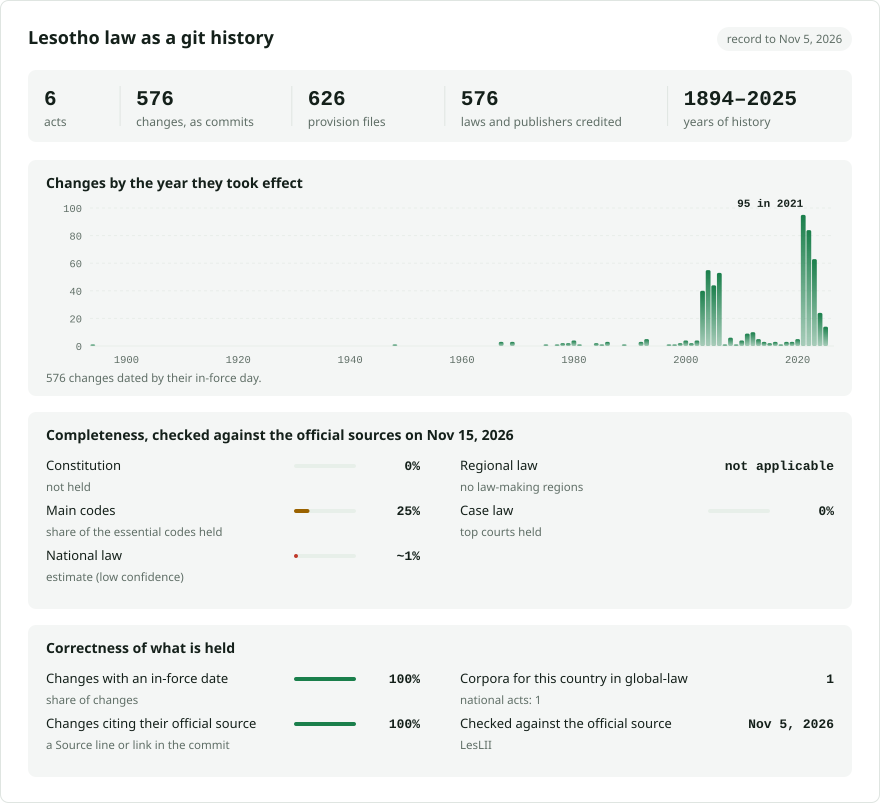

# Lesotho: law history in git

<picture>
<source media="(prefers-color-scheme: dark)" srcset="data/effort-dark.svg">

</picture>

The law of Lesotho as a git history: one file per provision, one commit per version on the day it took effect, and the law that made each change as the commit's author. `git blame` names the law behind every paragraph; `git log` lists every change to a provision; picking a date gives the text in force that day.

Part of [lexifina/global-law](https://github.com/lexifina/global-law), one git history for every country's law: this is Lesotho's national law, which global-law reads at `lesotho/national/acts/`.

**What is in it now:** 53 laws from 1967 to 2024: the Constitution of 1993 as it came into operation, with the two Orders that brought it into force; the Labour Code Order 1992; the Penal Code Act; the Land Acts of 1979 and 2010; and other acts, orders and legal notices on land, water, environment, energy, telecommunications, agriculture, crime and finance, mostly as first published. Six acts from LesLII have per-provision histories (the Money Laundering and Proceeds of Crime Act, 2008 in 5 versions, the Anti-Trafficking in Persons Act, 2011 in 2). Each act's `README.md` lists its provisions; [`data/versions.json`](data/versions.json) lists every version with its source.

Each act has its own folder. The LesLII acts have one file per provision: `anti-trafficking/sec-005.md` is section 5 of the Anti-Trafficking in Persons Act, 2011, the offence of trafficking. Laws read from PDF copies are one file each, `<folder>/full-text.md` (for example `constitution/full-text.md`).

The text is in English, the language Lesotho's laws are published in, as each source prints it (LesLII, the Government of Lesotho, WIPO Lex and FAOLEX); text from scanned Gazettes is the source's own text layer and keeps its scanning errors.

## Questions as git commands

| Question | Command |
| --- | --- |
| Every change to section 5 of the Anti-Trafficking in Persons Act | `git log -p --word-diff -- anti-trafficking/sec-005.md` |
| Which law wrote each line of section 5? | `git blame anti-trafficking/sec-005.md` |
| Every version of the Act, with the day each took effect | `git log --format="%h %(trailers:key=In-force,valueonly,separator=) %an" -- anti-trafficking ':!*/README.md'` |
| Section 5 as in force on 1 January 2015 | `python tools/on.py 2015-01-01 anti-trafficking sec-005` |

**Outside git**, we also host this record publicly, for free:

- **[Ask Claude about Lesotho law](https://global-law.lexifina.com/v1/try_claude?country=lesotho)**: opens Claude with a first question ready.
- **[Ask ChatGPT](https://global-law.lexifina.com/v1/try_chatgpt?country=lesotho)**: the same question in ChatGPT.
- **[Search Lesotho law on our site](https://lexifina.com/law?country=lesotho&q=trafficking)**: a search for "trafficking", with each provision's text and its versions, no account needed.
- **[Developer REST API](https://global-law.lexifina.com/v1/search_law?query=trafficking&jurisdiction=lesotho)**: the same search as JSON, with no key. See the [documentation here](https://lexifina.com/api/global-law).

Both assistants read the record through the free Global law connector (MCP, `https://global-law.lexifina.com/mcp`); the first time, the chat gives you the link that adds it. Ask in English.

**Host it yourself easily.** All it takes is git and Python, and the tools run on your machine:

```sh
git clone --depth 1 https://github.com/lexifina/global-law && cd global-law
python3 tools/countries.py add lesotho/national/acts
python3 tools/law.py show 2026-01-01 lesotho/national/acts/anti-trafficking/sec-005.md
```

Opened in Claude Code, Cursor, VS Code or Codex, the clone also starts a local MCP server with the same tools ([MCP.md](https://github.com/lexifina/global-law/blob/main/MCP.md)).

## Dates

Each commit is dated at noon, Africa/Maseru, on the day the version took effect, and carries it in its `In-force:` trailer:

- for an amendment, the day LesLII's dated version gives it ("Amended by ... on ..."): Act 1 of 2021 took effect on 14 January 2021;
- for an act as first published, the commencement LesLII states, else its Gazette day; the Money Laundering and Proceeds of Crime Act came into force in three stages (1 April 2009; sections 14 and 15 on 10 June 2011; section 18 on 1 July 2012), each its own commit;
- for a law read from a PDF copy, the commencement its own text or the source states, else its Gazette day; the `In-force-basis:` trailer says which (Land Act 2010: Gazette day, as its commencement notice is not held);
- commits are appended in the order they were built, not by date (the 2024 Act's comes after the 2026 documentation commits in `git log`), so ask for a date with `tools/on.py`, which reads the trailer.

The first version of each act is credited to the act as enacted (`Act 6 of 2012`), except the 2024 Act's, read from Government Gazette 21 of 2 April 2024 as the oldest version available and credited to the publisher, `LesLII`. Each later version is credited to the law LesLII names for it: a commencement notice (Legal Notice 68 of 2011), a notice amending a Schedule (Legal Notice 30 of 2013) or an amending Act (Act 1 of 2021); none is left unexplained.

## How it is checked

- `tools/check_repo.py` reads every version back from git on the day it took effect and on the day before, and compares it with the corpus: 11 versions of 6 acts, 0 mismatches, and no commit whose trailers git cannot parse (see [`REPRODUCE.md`](REPRODUCE.md)).
- Each version is parsed from an archived copy of its own dated LesLII page (the 2024 Act from the Gazette PDF LesLII holds), whose sha256 is recorded in `data/versions.json`; all of a version's text must land in a provision file.
- **Credits** come only from LesLII's own notes: each act's History, its commencements and the editorial notes in each provision.
- History is append-only: no merge commits, and no published commit is rewritten.
- [vulnerabilities/](vulnerabilities/): possible drafting mistakes in this law, found by global-law's detectors and checked by hand. Not run yet.

## What it does not show

- **The Constitution as amended.** Only its 1993 text as it came into operation is held; none of the amending Acts (1996 to 2025) is applied, as no source gives their texts with their commencement days.
- **Money laundering law after 2017.** LesLII lists the Money Laundering and Proceeds of Crime (Amendment) Act, 2016 (6 February 2017) and an Amendment of Schedule Notice, 2017 (30 June 2017), which its own latest version does not apply; from 6 February 2017 the text here is not the law in force.
- **Other law.** Most of Lesotho's statute book is not here: the laws held are those an open source publishes as text with a date; amendments made after a law's first publication are mostly not applied. There is no case law or bill.
- **Earlier history.** Every change before an act's oldest version here is folded into it.
- **Editorial matter.** LesLII's bracketed notes are read for credits only (kept where a provision has no other text), and Part, Chapter and Division headings are left out; each file starts with its own number and heading.
- **Changes within a line.** Each paragraph is one line (the 2024 Act keeps the Gazette's line breaks), so blame credits a whole paragraph to the law that changed one word of it.

## Sources

| Source | Kind | Past versions | Notes |
| --- | --- | --- | --- |
| [LesLII](https://lesotholii.org), the Lesotho Legal Information Institute (Laws.Africa Peachjam) | Free legislation, supported by the Judiciary, the Law Office and the Law Society | yes, dated versions; here only those archived | Each version's text and date, its History and editorial notes; its earlier website printed the 1993 Constitution |
| [Internet Archive](https://web.archive.org/) | Web archive | as captured | Archived copies of those LesLII pages, and of the Gazette PDF of the 2024 Act |
| [Government of Lesotho](https://www.gov.ls/) | Official | no | The Constitution of 1993 and its two commencement Orders |
| [WIPO Lex](https://www.wipo.int/wipolex/en/legislation/members/profile/LS) | Secondary copy | no | The Labour Code Order 1992, telecommunications law and other acts |
| [FAOLEX](https://www.fao.org/faolex/), via [ECOLEX](https://www.ecolex.org/) | Secondary copy | no | Gazette scans of land, water, environment, energy and agriculture law, with their text layers |

## Licence

See [`LICENSE`](LICENSE), which gives each source's terms. LesLII licenses its texts under CC BY-NC 4.0, crediting LesLII as the source, so they may be used only for non-commercial purposes; FAOLEX's copies are for non-commercial use with credit to FAO. Lexifina's own contributions (the arrangement of the history, the commit messages, the tables and the tools) are CC0 1.0.

No AI model wrote, translated or corrected legal text, and none runs when the history is built; the scripts were written by AI models, Claude and, for the 2024 Act, GPT-6 (see [`REPRODUCE.md`](REPRODUCE.md)).

## Visualisations

- [visualisations/](visualisations/): charts drawn from this repository. Not drawn yet.

## More

From [lexifina/global-law](https://github.com/lexifina/global-law):

- [FEATURES.md](https://github.com/lexifina/global-law/blob/main/FEATURES.md): every feature, and what every corpus must support (`git blame`, `law.py`, the MCP tools)
- [FAQ.md](https://github.com/lexifina/global-law/blob/main/FAQ.md): questions and answers · [CONTRIBUTING.md](https://github.com/lexifina/global-law/blob/main/CONTRIBUTING.md): proposing changes · [MCP.md](https://github.com/lexifina/global-law/blob/main/MCP.md): the MCP server · [REPRODUCE.md](https://github.com/lexifina/global-law/blob/main/REPRODUCE.md): how it was built · [CHANGELOG.md](https://github.com/lexifina/global-law/blob/main/CHANGELOG.md)
- [FRESHNESS.md](https://github.com/lexifina/global-law/blob/main/FRESHNESS.md): how current each corpus is · [Monitoring](https://github.com/lexifina/global-law/tree/main/monitoring): whether updates are running · [WATCHING.md](https://github.com/lexifina/global-law/blob/main/WATCHING.md): how each official source is watched for changes
- [performance/](https://github.com/lexifina/global-law/tree/main/performance): how fast the tools are, measured
- [visualisations/](https://github.com/lexifina/global-law/tree/main/visualisations): charts and bridges across the world's law
- [Vulnerabilities](https://github.com/lexifina/global-law/tree/main/vulnerabilities): mistakes in legislation as published
